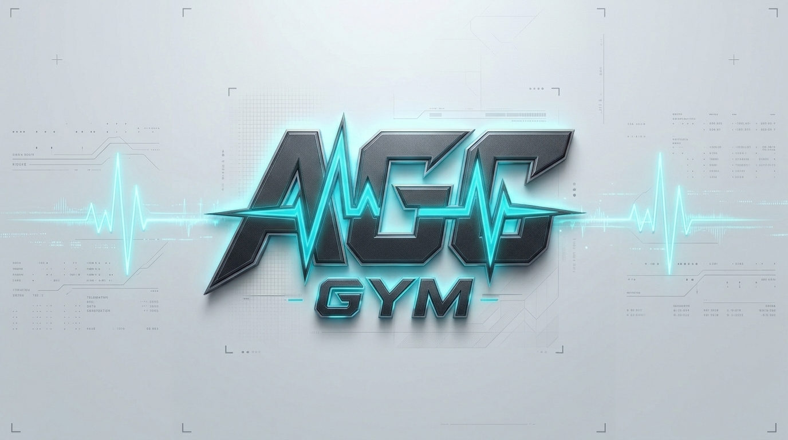
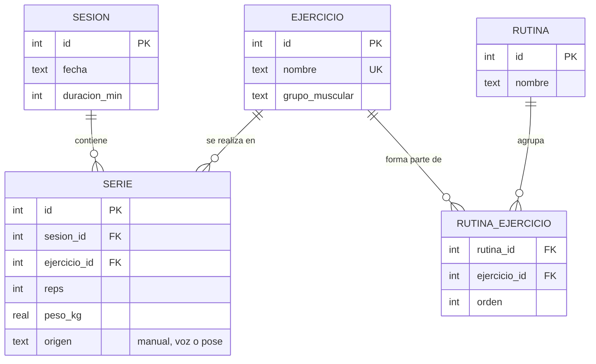

# AGC GYM

<p align="center">
  
</p>

**Diario de entrenamiento manos libres.** Aplicación Flutter para registrar sesiones de gimnasio con la máxima fluidez: a mano, por comandos de voz o mediante visión artificial con la cámara.

Proyecto de **Diseño de Interfaces** (2.º DAM, curso 2026/27) · Equipo: Ayoub Atidi Belbaz, Guillermo Martínez Martínez y Carlos Pérez Oller.


---

## Qué hace

- **10 pantallas** con `go_router`: Inicio, Rutinas, Detalle de rutina, Catálogo de ejercicios, Sesión en curso, Contador por pose, Historial, Detalle de sesión, Estadísticas y Ajustes (con la maqueta de AR).
- **Tema Material 3** generado con `ColorScheme.fromSeed` desde un azul eléctrico Tiffany. Arranca en **oscuro** y dispone de botón de alternancia rápida (barra superior y Ajustes) para pasar a **claro**. La preferencia se persiste en base de datos.
- **Voz** (`speech_to_text` + `flutter_tts`): *«añade tres series de sentadilla con sesenta kilos»* escribe en SQLite; *«cuánto volumen llevo»* y *«cuántas series llevo»* leen de SQLite. La app responde en voz alta.
- **Pose con visión artificial** (`camera` + ML Kit): detección de movimiento corporal en tiempo real con selector para 3 ejercicios:
  - **Sentadillas:** cálculo del ángulo cadera–rodilla–tobillo con aviso de *«sentadilla incompleta»* (por pantalla y voz).
  - **Burpees:** cálculo del ratio vertical de elongación corporal para registrar la transición de pie -> flexión en el suelo -> salto erguido.
  - **Dominadas (Pull-ups):** cálculo del ángulo de flexión de codo muñeca–codo–hombro con aviso de repetición incompleta si no se supera la barra.
  Todas las series registradas con la cámara se guardan automáticamente en SQLite con `origen = 'pose'`.
- **Marca de pies (maqueta de AR):** vista previa de la cámara con huellas 2D interactivas y ajustables (separación y tamaño) para posicionamiento correcto antes del levantamiento.
- **Componentes propios** (`packages/gym_components`): `RepCounter` (contador circular animado con objetivo) y `SetTile` (tarjeta de serie con swipe Dismissible y menú contextual), con Widgetbook, tests y documentación.
- **ES / EN** con ficheros ARB, plurales gramaticales y formato de fecha localizado según el idioma.
- **Privacidad:** datos 100% locales en el dispositivo (SQLite). Aviso de privacidad y gestión de permisos de micrófono y cámara en Ajustes.

## Puesta en marcha

Requisitos: Flutter estable reciente (Dart 3.6 o superior), Git y, para Windows, Visual Studio con la carga *Desarrollo para el escritorio con C++*. Para móvil, Android Studio y un emulador o un móvil con depuración USB.

> Mueve el proyecto a una ruta **sin espacios ni tildes** (por ejemplo `C:\dev\AGC_GYM`): el analizador de Dart falla con rutas como `Diseño de Interfaces`.

```bash
flutter pub get
flutter gen-l10n          # genera lib/l10n/app_localizations.dart (también lo hace flutter run)
flutter run -d windows    # o el id de un dispositivo / emulador: flutter devices
```

Comprobación completa en un paso: `powershell -ExecutionPolicy Bypass -File .\scripts\verificar.ps1`

### Validación y Pruebas en Dispositivos

La aplicación ha sido probada y verificada exhaustivamente tanto en **emuladores virtuales Android** como en **dispositivos físicos** y **entorno de escritorio (Windows)**:

- **10 pantallas y navegación fluida:** Flujo completo verificado con `go_router`, transiciones de pantalla y persistencia en tiempo real.
- **Base de datos SQLite:** Persistencia validada con `sqflite` en Android y `sqflite_common_ffi` en Windows. Creación, inserciones, actualizaciones, borrados y consultas con `JOIN` y agregados (`SUM`, `COUNT`).
- **Visión artificial por cámara (Pose NUI):** Ejecución en tiempo real con detección de pose en cámara para los tres ejercicios implementados:
  1. **Sentadillas:** cálculo del ángulo cadera–rodilla–tobillo con detección de repetición incompleta (< 100°).
  2. **Burpees:** cálculo del ratio vertical del cuerpo con detección de transición de pie -> suelo -> salto de pie.
  3. **Dominadas (Pull-ups):** cálculo del ángulo de flexión de codo muñeca–codo–hombro con aviso de dominada incompleta.
  Todas las repeticiones registradas mediante la cámara se guardan automáticamente en SQLite con `origen = 'pose'`.
- **Reconocimiento de voz y TTS:** Captura de órdenes por voz en lenguaje natural (*«añade tres series de sentadilla con sesenta kilos»*, *«cuánto volumen llevo»*) con confirmación hablada por síntesis de voz (TTS) y guardado directo en base de datos.
- **Alternativa táctil:** Todas las funciones naturales disponen de su correspondiente alternativa accesible por pulsación táctil (botón `+1 manual`, diálogos de edición).
- **Atajos de teclado:** Soporte de controles rápidos de teclado (`Ctrl+N` para nueva serie, `Espacio` para incrementar repetición).

## Arquitectura (MVC)

```
lib/
├─ main.dart, app.dart     Arranque, providers, tema, idiomas
├─ core/                   Tema, router, formateadores, constantes
├─ data/                   DatabaseHelper, modelos y repositorios (SQLite)
├─ controllers/            ChangeNotifier (un controlador por pantalla)
├─ nui/                    Voz, TTS, pose, analizadores (sentadilla, burpee, dominada)
├─ views/                  Pantallas y widgets
└─ l10n/                   app_es.arb y app_en.arb
packages/gym_components/   Paquete propio (RepCounter, SetTile) + Widgetbook
```

- Los controladores de pantallas con parámetro (sesión, detalle, pose) se crean en el router.
- `PRAGMA foreign_keys = ON` en `onConfigure`; consultas preparadas con `whereArgs`.
- La lógica de voz (`VoiceCommandParser`) y de pose (`SquatAnalyzer`, `BurpeeAnalyzer`, `PullUpAnalyzer`) es Dart puro desacoplada del hardware, validada con suites completas de tests unitarios.

### Modelo de datos



Más la tabla `ajuste` (clave/valor) donde se guardan tema e idioma. La BD (versión 2) se crea con datos de ejemplo la primera vez.

## Interfaz natural: decisiones

- **Voz:** las órdenes se reconocen **en español** (el parser entiende tildes, números en palabras, «y medio» y plurales). La interfaz puede estar en inglés, pero la voz sigue siendo en español para máxima precisión de entrenamiento.
- **AR:** se entrega como **maqueta con cámara y superposición 2D**, permitiendo al usuario ajustar la posición y apertura de los pies en el suelo antes de levantar peso.
- **Pose:**
  - **Sentadillas (`SquatAnalyzer`):** se usa el lado del cuerpo con mejor fiabilidad (≥ 0,5). De pie ≥ 160°, bajada válida ≤ 100°, y aviso sonoro/visual si vuelve a subir sin romper el paralelo.
  - **Burpees (`BurpeeAnalyzer`):** ratio vertical de torso/envergadura. Detecta de pie (> 0,40), fase en suelo/plancha (< 0,26) y retorno a la verticalidad (> 0,40).
  - **Dominadas (`PullUpAnalyzer`):** ángulo de codo muñeca–codo–hombro. Colgado ≥ 145°, flexión máxima superando la barra ≤ 75°, con aviso si desciende sin completar el recorrido.

## Tests

```bash
flutter test                                             # app (parser, analizadores, modelos, SQLite, widgets)
cd packages/gym_components && flutter test --coverage   # paquete (unit, widget, golden)
```

Los *golden* se generan solos la primera vez (`test/goldens/`); súbelos al repositorio. Widgetbook: `cd packages/gym_components/widgetbook && flutter run -d windows`. Documentación del paquete: `cd packages/gym_components && dart doc`.

## Flujo del equipo

Tareas en Jira (proyecto `KAN`). Commits semánticos `tipo(KAN-xx): descripción`, pequeños y frecuentes.

| Fecha | Hito |
|---|---|
| 24/10/2026 | Inicio del proyecto y arquitectura base |
| 30/10/2026 | Hito 1: Interfaces y persistencia SQLite |
| 05/11/2026 | Congelación de código y pruebas NUI completas |
| 11/11/2026 | Exposición del proyecto |
| 17/11/2026 | Hito 2 y Entrega final |

## Equipo

| Nombre | Tareas principales |
|---|---|
| Ayoub Atidi Belbaz | Base de datos SQLite, sesión en curso con Dismissible/atajos, reconocimiento de voz y TTS, detector de burpees por pose, componente `RepCounter`, tests y documentación |
| Guillermo Martínez Martínez | Tema Tiffany claro/oscuro, router y navegación, historial y detalle de sesión, detector de sentadillas y dominadas por pose con avisos, componente `SetTile` con golden tests |
| Carlos Pérez Oller | Catálogo de ejercicios con CRUD y filtros, rutinas y detalle, estadísticas con gráfica de volumen semanal (`fl_chart`), ajustes y permisos, maqueta AR con cámara, Widgetbook e internacionalización ES/EN |
